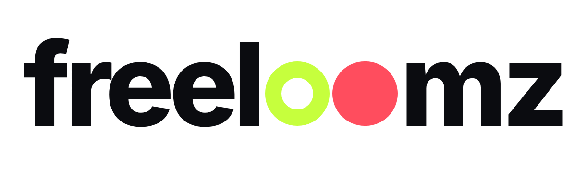
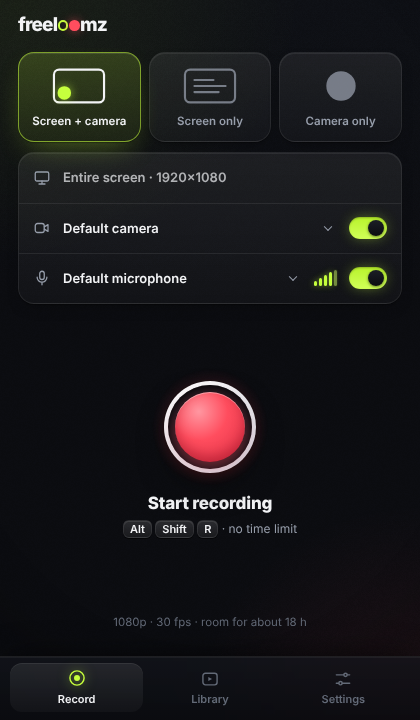
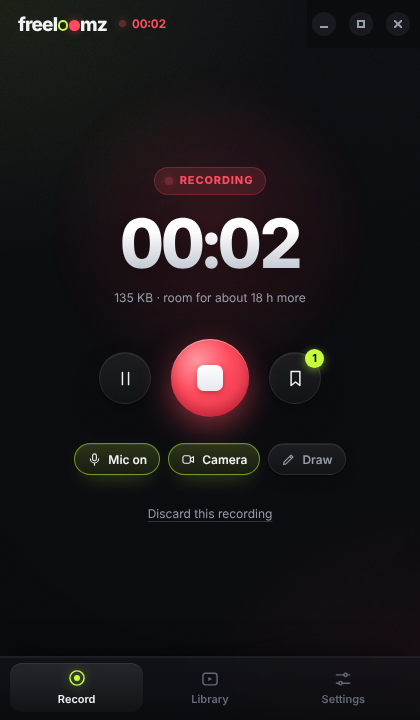
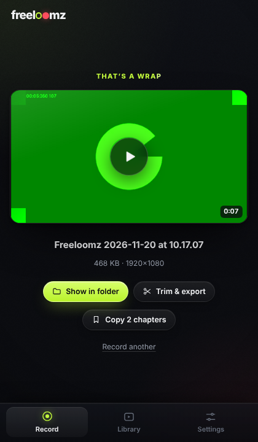

<p align="center">
  <picture>
    <source media="(prefers-color-scheme: dark)" srcset="docs/wordmark-dark.png" />
    
  </picture>
</p>

<p align="center"><b>Record your screen and your face. For as long as you like. For free.</b><br />
No time limits · no accounts · no watermark · nothing leaves your computer</p>

<p align="center">
  
  
  
</p>

Freeloomz is a desktop app for making walkthroughs, tutorials and how-to videos: it records your whole screen with your webcam in a round bubble you can park in any corner, plus your microphone. The free tiers of the usual tools cut you off after five minutes. This one doesn't cut you off at all.

It runs on **macOS, Windows and Linux**.

## What it does

**Recording**

- **Whole-screen capture** with your pointer, on whichever display you choose
- **Camera bubble** — a round (or rounded-square) webcam window that floats above everything. Drag it anywhere, it snaps to corners; scroll over it to resize; right-click for options
- **Microphone** with a live level meter, so you know you're being heard before you start
- **Computer sound** too, on Windows and on macOS 14.2 or newer
- Three modes: **screen + camera**, **screen only**, **camera only**
- **No time limit.** Video is written to disk as you go, so an hour-long recording uses no more memory than a minute-long one
- **Pause and resume** — paused time never ends up in the video
- **3-2-1 countdown** (or 5, or 10, or none)
- **720p to 4K or native resolution**, 15 / 30 / 60 fps, three quality levels

**Made for how-to videos**

- **Chapter markers** — tap a shortcut while recording to mark a new section. Markers are saved into the video file *and* can be copied as a timestamp list that YouTube turns into chapters
- **Cursor highlight** — a soft halo that makes your pointer easy to follow
- **Draw on screen** — circle things and point at them mid-explanation; the ink fades when you're done
- **Global shortcuts** for everything, so the app stays out of your recording
- The Freeloomz window **hides itself** while you record

**Afterwards**

- Saved automatically as a regular **MP4** (H.264 + AAC) that plays everywhere and uploads anywhere. No export step, no save dialog
- A **library** with thumbnails, rename, show-in-folder and trash
- **Trim** the fumbling off the start and end
- **Export a GIF** of a short clip for docs and READMEs

**Never loses your work**

- If the app or the computer crashes mid-recording, Freeloomz offers to **recover** it next time you open it
- If the disk fills up, it stops and saves what you have instead of corrupting the file
- If a recording can't be processed for any reason, the raw file is kept, not deleted

## Install

Download the installer for your computer from the [Releases page](https://github.com/chchchadzilla/Freeloomz/releases):

| Your computer | File |
| --- | --- |
| Mac with Apple silicon (M1 or later) | `Freeloomz-…-mac-arm64.dmg` |
| Mac with an Intel processor | `Freeloomz-…-mac-x64.dmg` |
| Windows 10 / 11 | `Freeloomz-Setup-….exe` |
| Linux | `Freeloomz-…-linux-x86_64.AppImage` |

Freeloomz is not yet signed with a paid Apple or Microsoft developer certificate, so your computer will ask you to confirm the first time:

- **macOS** — open the app, and when macOS blocks it go to **System Settings → Privacy & Security**, scroll down and click **Open Anyway**. macOS then asks permission for screen recording, camera and microphone; after allowing screen recording it will ask you to reopen the app.
  Until the app is signed, macOS may ask for those permissions again after you install an update.
- **Windows** — on the blue "Windows protected your PC" screen click **More info → Run anyway**.
- **Linux** — make the AppImage executable (`chmod +x Freeloomz-*.AppImage`) and run it.

## Using it

Open Freeloomz, press the big red button, talk. Press the shortcut (or the tray icon) to stop. Your video is in your Videos (or Movies) folder under `Freeloomz`.

| Shortcut | What it does |
| --- | --- |
| `Alt` `Shift` `R` | Start / stop recording |
| `Alt` `Shift` `P` | Pause / resume |
| `Alt` `Shift` `K` | Add a chapter marker |
| `Alt` `Shift` `C` | Show / hide the camera bubble |
| `Alt` `Shift` `M` | Mute / unmute the microphone |
| `Alt` `Shift` `D` | Draw on screen (`Esc` to finish) |

On a Mac, `Alt` is the `⌥ Option` key. Every shortcut can be changed or switched off in **Settings**.

While recording you can also hover over the camera bubble for stop and pause buttons, or use the Freeloomz icon in the menu bar / system tray.

## Privacy

Freeloomz has no server, no account, no analytics and no telemetry. It makes no network requests at all. Your recordings are ordinary files on your own disk.

## Build it yourself

You need [Node.js](https://nodejs.org) 22 or newer.

```bash
git clone https://github.com/chchchadzilla/Freeloomz.git
```

```bash
cd Freeloomz
```

```bash
npm install
```

```bash
npm start
```

To build an installer for the computer you're on:

```bash
npm run dist
```

### Tests

```bash
npm test
```

runs the unit and pipeline tests (settings, file naming, chapter maths, the on-disk recording pipeline against the real bundled ffmpeg, crash recovery).

```bash
npm run test:e2e
```

launches the real app and makes real recordings: countdown, pause, chapters, rename, trim, GIF export, crash recovery, the camera bubble's dragging and snapping, and a pixel-level check that the screen, the bubble and the pointer end up in the video. On Linux it starts its own virtual display.

```bash
npm run test:soak
```

records for 6½ minutes while watching memory, and checks the file is complete and in sync with the clock. Set `SOAK_MINUTES=60` for a longer run.

### How it's put together

Freeloomz is an [Electron](https://www.electronjs.org) app in plain JavaScript — no bundler, no framework, no build step.

```
src/
  main/        the app itself: windows, the recording state machine, files
    controller.js         every way of controlling a recording ends up here
    recording-session.js  crash-safe storage + turning a recording into an MP4
    windows.js            control panel, camera bubble, countdown, overlay
    library.js            the recordings folder, thumbnails, rename
  renderer/
    control/   the main window, and the capture engine (engine.js)
    bubble/    the camera bubble
    overlay/   cursor highlight + drawing
    countdown/
    shared/    design tokens (theme.css) and the motion system (motion.js)
  shared/      pure logic used on both sides, fully unit-tested
  preload/     the one narrow bridge between windows and the app
```

A few decisions worth knowing about:

- **The camera bubble is a real window on your screen**, so it's simply part of what gets recorded. What you see is exactly what you get.
- **Video goes to disk every second** as it is encoded, next to a small journal file. That is what makes recordings unlimited in length and recoverable after a crash.
- **Recording uses H.264 where the system offers it**, so finishing a recording only has to re-wrap the video into an MP4 — a second or two, even for an hour of footage.
- [ffmpeg](https://ffmpeg.org) (bundled via [`ffmpeg-static`](https://github.com/eugeneware/ffmpeg-static)) does the finishing, trimming, thumbnails and GIFs.

### Releasing

Pushing a tag such as `v0.1.0` makes GitHub Actions build the installers for all three systems and attach them to a draft release. Running the **Build installers** workflow by hand produces the same files as downloadable artifacts.

To get rid of the first-run warnings, sign the builds: set `CSC_LINK` / `CSC_KEY_PASSWORD` (and Apple notarization credentials) as repository secrets, remove `"identity": "-"` and `"hardenedRuntime": false` from the `mac` section of `package.json`, and add camera and microphone entitlements. See the [electron-builder code-signing guide](https://www.electron.build/code-signing).

## Roadmap

- **Share live** — a built-in server so anyone with a link can watch as you record, or watch the finished video, without uploading it anywhere
- Record a single window or a region, with the camera composited in
- Click ripples and on-screen keystrokes
- Automatic captions and searchable transcripts, generated on your own machine
- Auto-zoom on what you're pointing at
- A speaker-notes window that's visible to you but not to the recording
- Signed builds and automatic updates

Ideas and pull requests are welcome.

## License

[MIT](LICENSE) © Chad Keith. Do what you like with it.

The bundled ffmpeg is a separate program under its own licence (GPL); see [ffmpeg.org/legal.html](https://ffmpeg.org/legal.html).

Freeloomz is an independent project and is not affiliated with, endorsed by, or connected to Loom or Atlassian.
